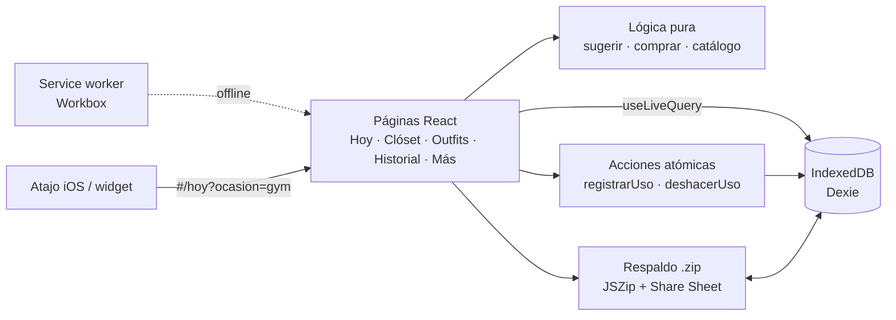

# 👗 Mi Armario

**Web app instalable (PWA) que te dice qué ponerte con la ropa que ya tienes, rota todo el clóset y te frena antes de comprar algo repetido.**

[](https://github.com/marianaph6/mi-armario/actions/workflows/publicar.yml)


**▶ Demo:** https://marianaph6.github.io/mi-armario/ — ábrela en Safari del iPhone y toca *Compartir → Agregar a pantalla de inicio*.

---

## El problema

Con una rutina repetitiva (home office, gym una o dos veces al día, un día de oficina y salidas ocasionales) es fácil terminar usando siempre las mismas cinco prendas, olvidar cómo se combinaba la ropa de deporte y comprar algo casi idéntico a lo que ya está colgado.

## La solución

Una app que vive en la pantalla de inicio del teléfono, funciona sin internet y no necesita cuenta:

| Pantalla | Qué hace |
|---|---|
| **Hoy** | Elige la ocasión (casa, gym, oficina, salida) y recibe un outfit armado con lo que está limpio y lleva más tiempo sin usarse. Se puede cambiar una prenda, pedir otra opción, guardarlo o registrarlo con *Me lo pongo*. |
| **Clóset** | Cada prenda con foto, tipo, color, ocasiones y clima. Filtros y estado *limpia / para lavar*. |
| **Outfits** | Combinaciones guardadas y favoritas, sobre todo para el gym. |
| **Historial** | Lo que te pusiste cada día. Permite registrar días pasados para no perder la traza. |
| **Antes de comprar** | Indica cuántas prendas parecidas ya tienes y con cuántas combinaría lo que piensas comprar. Incluye lista de deseos. |
| **Estadísticas** | Prendas sin estrenar, olvidadas, las más usadas y cuánto del clóset rotaste en el mes. |
| **Respaldo** | Exporta e importa un `.zip` con datos y fotos, con aviso si pasan 14 días sin copia. |
| **Widget** | Un Atajo de iOS abre la app directo en *¿qué me pongo para el gym?* mediante deep links (`#/hoy?ocasion=gym`). |

---

## Decisiones técnicas

- **Local-first, sin backend.** Todo se guarda en IndexedDB (Dexie): no hay servidor, cuentas ni costos, y la privacidad está garantizada por diseño. La app pide `navigator.storage.persist()` para que Safari no borre los datos.
- **PWA en lugar de app nativa.** Se instala desde Safari, funciona offline gracias al service worker de Workbox y se actualiza sola. iOS no permite widgets web, así que el "widget" es un Atajo que abre rutas con deep link (por eso se usa `HashRouter`).
- **Motor de sugerencias por reglas, sin IA.** Es un módulo puro (sin acceso a la base de datos, con el azar y la fecha inyectables), cubierto por pruebas y fácil de ajustar. Detalle abajo.
- **Fotos livianas.** Se comprimen en el dispositivo (`browser-image-compression`) a 1200 px / ~250 KB, más una miniatura de 400 px para las cuadrículas. 200 prendas ocupan unos 30 MB.
- **Respaldo portable.** Es un `.zip` (JSZip) con `datos.json` y las fotos, que se guarda con la hoja de compartir de iOS en Archivos o iCloud. La importación se valida antes de reemplazar nada.
- **Operaciones atómicas.** Registrar o deshacer un uso actualiza el registro, los contadores, el último uso y el estado de lavado en una sola transacción.

## Motor de sugerencias

[`src/logic/sugerir.ts`](src/logic/sugerir.ts) arma candidatos con plantillas por ocasión (`superior + inferior` o `enterizo`, más calzado fuera de casa) usando solo prendas limpias de esa ocasión, y puntúa cada combinación:

| Criterio | Efecto |
|---|---|
| Días sin usar cada prenda (tope 30) | **+** prioriza lo olvidado |
| Pocos usos totales | **+** rota todo el clóset |
| Prenda ya usada hoy (gym dos veces) | **−** |
| Armonía de color: neutros libres, máximo un color fuerte, no dos estampados | **+ / −** |
| Prendas de calor mezcladas con prendas de frío | **−** |
| El mismo outfit en los últimos 7 días | **−** |
| Outfit guardado / favorito | **+** |

La primera opción se elige al azar entre las 5 mejores, para que haya variedad. Las siguientes penalizan las prendas repetidas para que *Otra opción* muestre algo realmente distinto.

## Arquitectura



## Stack

| Área | Tecnología |
|---|---|
| UI | React 19, React Router 7, Tailwind CSS 4 |
| Lenguaje | TypeScript en modo estricto |
| Datos | Dexie 4 (IndexedDB) + `dexie-react-hooks` |
| PWA | `vite-plugin-pwa` (Workbox), manifest e íconos propios |
| Build | Vite 8 |
| Pruebas | Vitest |
| Calidad | Oxlint |
| CI/CD | GitHub Actions → GitHub Pages |

## Estructura

```
src/
├── pages/        # pantallas: Hoy, Clóset, Outfits, Historial, Antes de comprar, Estadísticas…
├── components/   # piezas reutilizables: Sugerencia, SelectorPrendas, Collage, Respaldo…
├── db/           # esquema Dexie y acciones transaccionales
├── logic/        # lógica pura y testeada: sugerencias, compras, catálogo, respaldo
└── lib/          # utilidades: compresión de imágenes, fechas, hooks
```

## Correr el proyecto

Requiere Node 20 o superior.

```bash
npm install
npm run dev      # servidor local, también accesible desde el celular en la misma Wi-Fi
npm test         # 13 pruebas del motor de sugerencias y de "antes de comprar"
npm run build    # versión de producción en dist/
npm run lint
```

## Despliegue continuo

Cada push a `main` dispara [`publicar.yml`](.github/workflows/publicar.yml): instala dependencias, corre las pruebas, compila y publica en GitHub Pages. Si una prueba falla, no se publica. Los datos de quien usa la app nunca se tocan, porque viven en su dispositivo.

## Próximos pasos

- Quitar el fondo de las fotos de prendas directamente en el dispositivo.
- Sugerencias según el clima del día.
- Widget nativo de iOS (SwiftUI) que muestre el outfit sin abrir la app.

---

Hecho por [**@marianaph6**](https://github.com/marianaph6).
